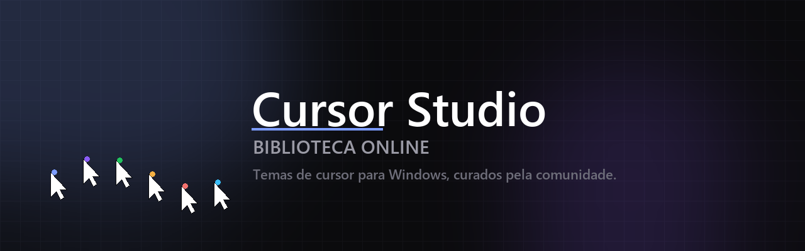
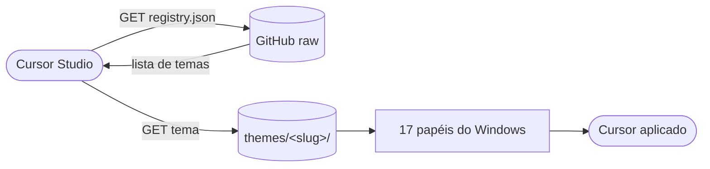

<div align="center">



# Cursor Studio · Biblioteca Online

**Temas de cursor para o Windows, curados pela comunidade.**

[](LICENSE)
[](#temas-disponíveis)
[](CONTRIBUTING.md)
[](docs/FORMATO.md)
[](https://github.com/TalesRamosDev/cursor-studio)

A Biblioteca Online é o catálogo oficial de temas do **[Cursor Studio](https://github.com/TalesRamosDev/cursor-studio)**.
Cada tema é uma pasta com cursores `.ani` / `.cur` do Windows, pronta para ser aplicada
em um clique — sem instalador, sem serviço em segundo plano.

</div>

---

## Como funciona

O app lê o arquivo **[`registry.json`](registry.json)** deste repositório. Tudo o que
está listado ali aparece na aba **Comunidade**, do lado de dentro do Cursor Studio.



| Peça | Onde vive | Para que serve |
| :--- | :--- | :--- |
| `registry.json` | raiz | Índice de todos os temas publicados |
| `themes/<slug>/theme.json` | pasta do tema | Metadados: nome, autor, licença, cursores |
| `themes/<slug>/preview.png` | pasta do tema | Imagem do cartão na comunidade |
| `themes/<slug>/cursors/` | pasta do tema | Os arquivos `.ani` / `.cur` |
| `themes/schema.json` | `themes/` | Contrato que a validação aplica |

> [!IMPORTANT]
> Um tema **não** é um arquivo compactado. É uma pasta com cursores e um
> `theme.json` descrevendo o papel de cada arquivo. O app copia os cursores para
> a pasta de temas do usuário e aplica — nada é executado.

---

## Baixar um tema

### Pelo app (recomendado)

1. Abra o **Cursor Studio**.
2. Vá em **Comunidade** na barra lateral.
3. Escolha um tema e clique em **Instalar**.
4. Clique em **Aplicar** quando quiser ativá-lo — a instalação só copia os arquivos.

### Manualmente

1. Entre na pasta `themes/<slug>/cursors/` do tema.
2. Baixe os arquivos `.ani` e `.cur`.
3. No Cursor Studio, vá em **Biblioteca → Novo tema → Selecionar pasta…**
4. Aponte para a pasta onde salvou os arquivos e dê um nome ao tema.

Alternativa fora do app: copie os cursores para `%LOCALAPPDATA%\CursorStudio\Themes\<nome>\`
e o Cursor Studio passa a listá-los na Biblioteca.

---

## Temas disponíveis

<!-- A tabela é gerada pelo workflow: não edite à mão. -->
<!-- THEMES:START -->

| Tema | Autor | Cursores | Licença | Prévia |
| :--- | :--- | :---: | :---: | :---: |
| **Aurora** | Cursor Studio | 3 | MIT | [ver](themes/example-aurora/preview.png) |

<!-- THEMES:END -->

<p align="center"><sub>O tema <strong>Auroraa</strong> é o exemplo oficial do formato — sirva-se dele como ponto de partida.</sub></p>

---

## Contribuir

Tem um tema bom no seu disco? Ele pode entrar na comunidade.

```bash
# 1. Fork e clone
git clone https://github.com/<voce>/cursor-studio-themes
cd cursor-studio-themes

# 2. Crie a pasta do tema a partir do exemplo
cp -r themes/example-Auroraa themes/meu-tema

# 3. Ajuste os metadados e coloque seus cursores em themes/meu-tema/cursors/

# 4. Valide antes de abrir o PR (o mesmo comando roda na CI)
node tools/validate.mjs

# 5. Adicione o tema ao registry.json e abra o Pull Request
```

O guia completo — nomenclatura de arquivos, papéis do Windows, checklist de
revisão — está em **[CONTRIBUTING.md](CONTRIBUTING.md)**.

> [!TIP]
> Em dúvida sobre o papel de um arquivo? A tabela dos 17 papéis do Windows, com
> todos os nomes reconhecidos, está em **[docs/FORMATO.md](docs/FORMATO.md)**.

---

## O que o Cursor Studio faz com os cursores

O Windows tem **17 papéis de cursor**. Um pack grande costuma ter cursores que não
têm papel próprio — o app dobra esses arquivos no papel mais próximo e avisa na
tela que aquele encaixe é aproximado, em vez de descartar o arquivo em silêncio.

| Recurso | Onde |
| :--- | :--- |
| Motor de cliques com efeitos `.bgra` | [cursor-studio](https://github.com/TalesRamosDev/cursor-studio) |
| Temas locais e packs | [cursor-studio](https://github.com/TalesRamosDev/cursor-studio) |
| Catálogo da comunidade | este repositório |

---

<div align="center">

**[Contribuir](CONTRIBUTING.md)** · **[Formato](docs/FORMATO.md)** · **[App](https://github.com/TalesRamosDev/cursor-studio)**

<sub>Feito para quem passa o dia inteiro na mesma seta.<br />
Licença [MIT](LICENSE) · os temas mantêm a licença de seus autores.</sub>

</div>
